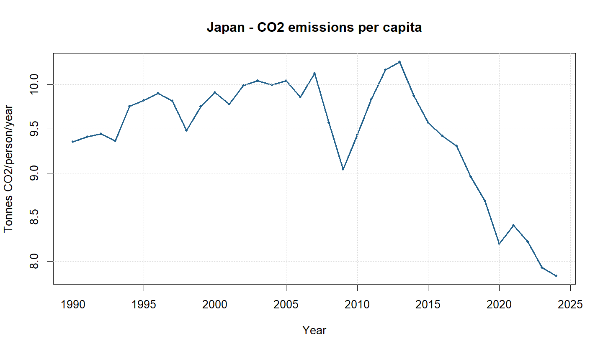

# co2-emissions-JPN
CO2 Emissions Analysis: Japan

**Student**: Laurence Baldelovar
**Country / ISO-3**: Japan / JPN
**Study period**: 1990–2024
**Declared to instructor on**: November 14, 2026

**Research question**

How have annual CO₂ emissions and per-capita CO₂ emissions changed in Japan from 1990 to 2024?

From 1990 to 2024, Japan's annual CO₂ emissions and per-capita CO₂ emissions generally decreased over the long term, although some years showed increases and fluctuations. Annual emissions represent the total amount of CO₂ released by the country each year, while per-capita emissions represent the average emissions per person. Examining these indicators helps describe changes in Japan's overall carbon emissions and average emissions per resident.

**Data source and definitions**

Our World in Data (OWID), CO₂ and Greenhouse Gas Emissions dataset. The analysis script downloads the full dataset from the official OWID data endpoint and extracts only Japan's records.

**Source dataset**: https://owid-public.owid.io/data/co2/owid-co2-data.csv

**Download date:** November 14, 2026

Selected columns: country, iso_code, year, co2, and co2_per_capita.

co2: Annual CO₂ emissions from fossil fuels and industrial processes, excluding land-use change, in million tonnes.

co2_per_capita: Annual CO₂ emissions per person, in tonnes/person/year.

These are emissions estimates, not atmospheric CO₂ concentrations or measurements of all greenhouse gases. Missing values are retained as missing and are not changed to zero.

**Software**

R and RStudio

Git, configured for use by RStudio

The analysis uses base R and does not require additional R packages.

**How to reproduce the analysis**

Clone this repository and open it as an RStudio Project.

Ensure RStudio's working directory is the repository root.

Connect to the internet for the initial full-dataset download.

In the RStudio Console, run:

source("scripts/analyze_co2.R")

The script creates the country-only dataset in data/, figures in figures/, and numerical outputs in results/.

The complete multi-country source file, data/owid-co2-data.csv, must remain local and must not be committed.

**Results**

Earliest year with valid annual emissions: 1990, 1,154.24 million tonnes CO₂/year.

Latest year with valid annual emissions: 2024, 969.62 million tonnes CO₂/year.

Change between those endpoints: 15.99% decrease.

Peak annual emissions: 2013, 1,310.01 million tonnes CO₂/year.

Latest available per-capita estimate: 2024, 7.84 tonnes/person/year.
## Figures

### Annual CO2 Emissions

### CO2 Emissions Per Capita

### Annual Percentage Change

# Japan CO₂ Emissions Analysis (1990–2024)

Interpretation (200–300 words)

Japan's annual CO₂ emissions changed throughout the 1990–2024 study period. In 1990, emissions were approximately 1,154.24 million tonnes. They generally increased over the following years and reached their highest recorded level in 2013 at approximately 1,310.01 million tonnes. This indicates that Japan's total CO₂ emissions were higher during the earlier part of the study period.

After 2013, annual emissions showed a general declining trend. From 2014 to 2019, emissions decreased each year. In 2020, they declined by another 5.84%. However, emissions increased by 2.04% in 2021 before decreasing again from 2022 to 2024. By 2024, emissions had reached approximately 969.62 million tonnes, representing a 15.99% decrease compared with 1990.

Per-capita emissions also decreased over the study period. They declined from approximately 9.35 tonnes per person in 1990 to 7.84 tonnes per person in 2024. This shows a reduction in both the country's total annual emissions and its average emissions per resident.

Changes in energy consumption, economic activities, and the use of different energy sources may help explain these trends. However, the dataset alone cannot establish the exact causes of the changes.

Overall, Japan's emissions in 2024 were lower than its 1990 level. Continued efforts to improve energy efficiency, expand renewable energy, and reduce fossil-fuel consumption are important for reducing emissions and addressing climate change.

**Limitations**

The OWID CO₂ indicator covers fossil-fuel and industrial-process emissions and excludes land-use change; it is not a measure of all greenhouse gases. Territorial accounting assigns emissions to the country where they occur and does not, by itself, capture emissions embodied in imported goods. Missing observations are not treated as zero. Country-level annual data also cannot identify the exact causes of changes without additional evidence.

**References**

Our World in Data. CO₂ and Greenhouse Gas Emissions dataset.

https://owid-public.owid.io/data/co2/owid-co2-data.csv
