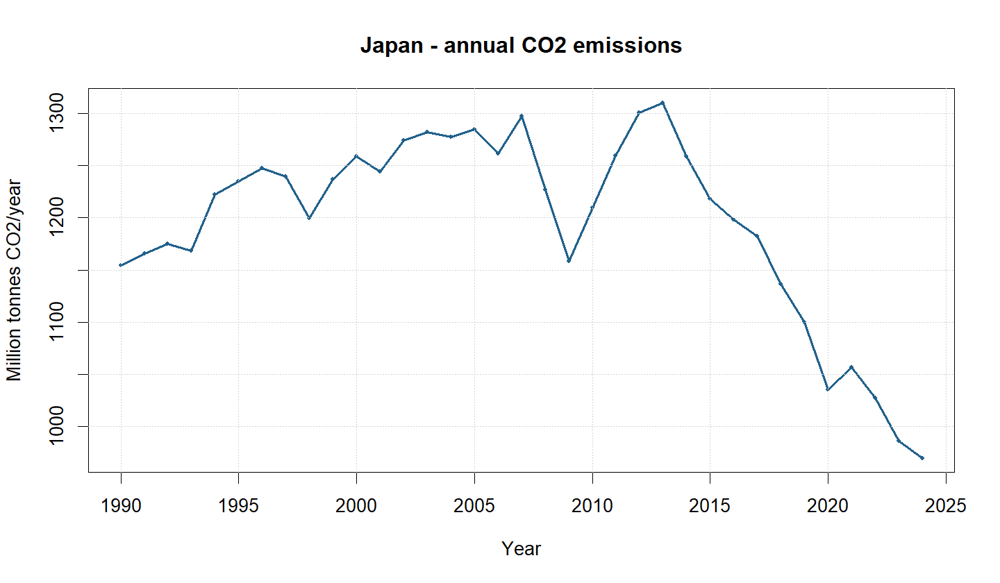
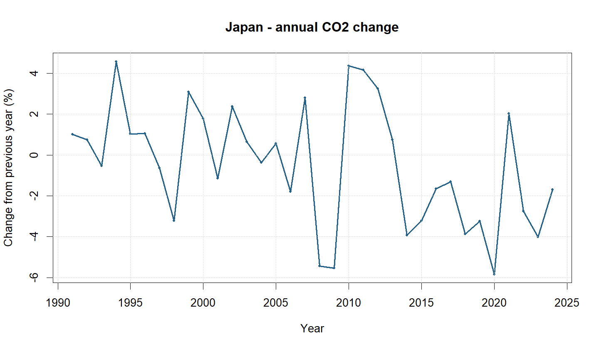

# co2-emissions-JPN
## Figures

### Annual CO2 Emissions

### CO2 Emissions Per Capita

### Annual Percentage Change

# Japan CO₂ Emissions Analysis (1990–2024)

## 1. Introduction

This project examines the carbon dioxide (CO₂) emissions of Japan from 1990 to 2024. It aims to identify changes in the country's annual emissions and emissions per capita over the selected period. The analysis uses data from Our World in Data.

## 2. Country Information

- **Country:** Japan
- **ISO-3 Code:** JPN
- **Study Period:** 1990–2024
- **Main Variable:** Annual CO₂ emissions
- **Additional Variable:** CO₂ emissions per capita
- **Data Source:** Our World in Data

## 3. Methodology

The analysis was conducted using RStudio and base R functions. The Our World in Data CO₂ dataset was downloaded and filtered to include only Japan using its ISO-3 country code (JPN).

The selected data were limited to the years 1990–2024. Annual CO₂ emissions, emissions per capita, and year-to-year percentage changes were examined. Summary statistics, tables, and graphs were generated to observe the trends and changes throughout the study period.

## 4. Key Results

- Japan's CO₂ emissions in 1990 were approximately **1,154.24 million tonnes**.
- In 2024, emissions decreased to approximately **969.62 million tonnes**.
- The overall decrease from 1990 to 2024 was approximately **15.99%**.
- The highest recorded emissions occurred in **2013**, reaching approximately **1,310.01 million tonnes**.
- CO₂ emissions per capita decreased from **9.35 tonnes** in 1990 to **7.84 tonnes** in 2024.

## 5. Interpretation

## 6. Figures

## 7. Data and Files

The project contains the R script, filtered country dataset, generated figures, and summary results. The original full multi-country dataset is excluded from the GitHub repository using `.gitignore`.

## 8. Limitations

This analysis uses secondary data from Our World in Data. The results describe changes in CO₂ emissions but do not establish the exact causes of those changes. The analysis is also limited to the selected years and variables.